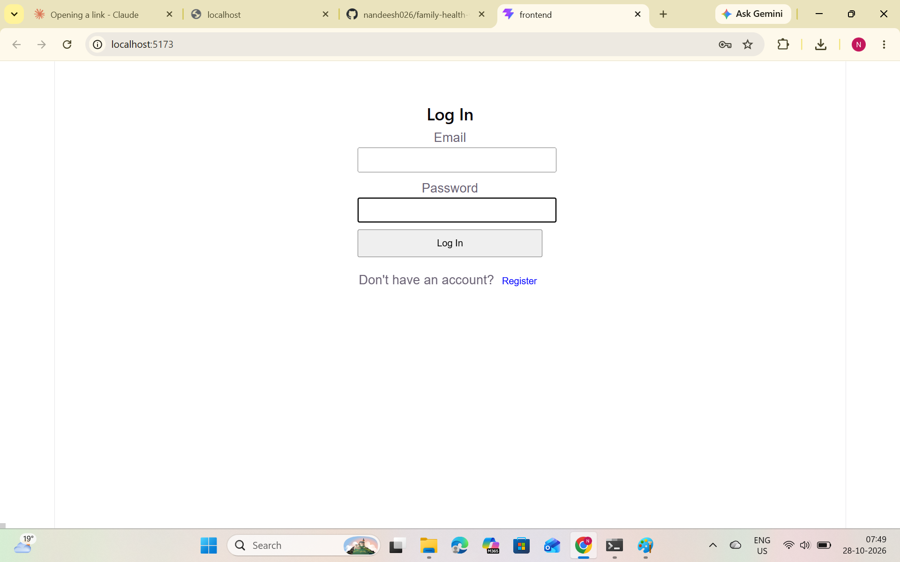
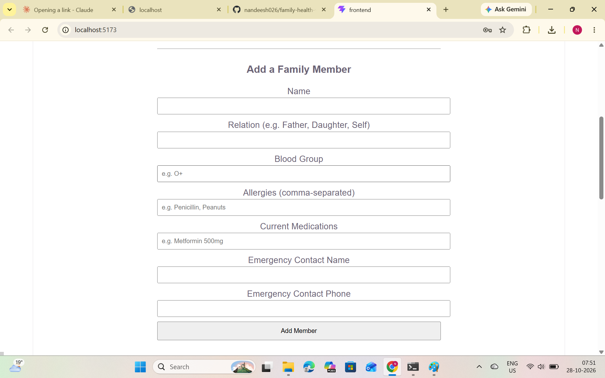
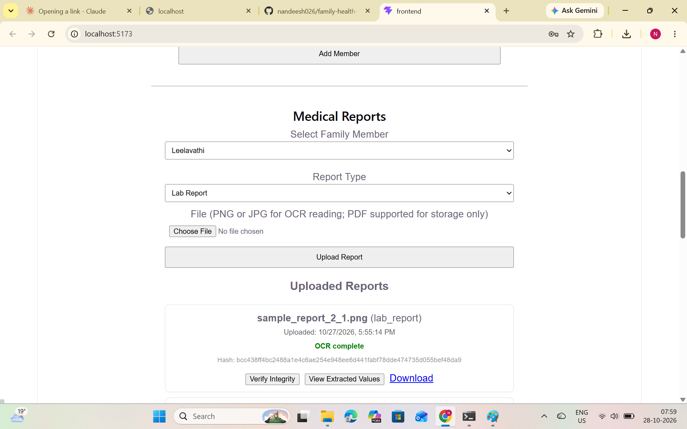
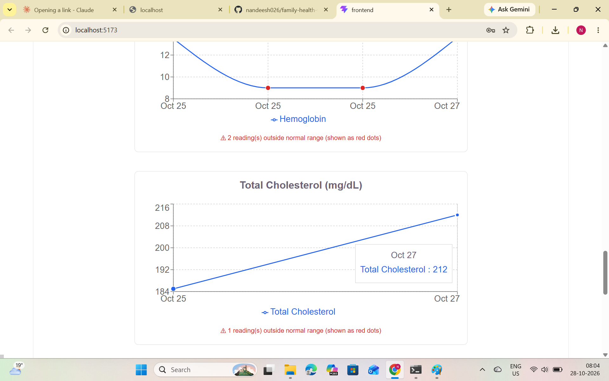
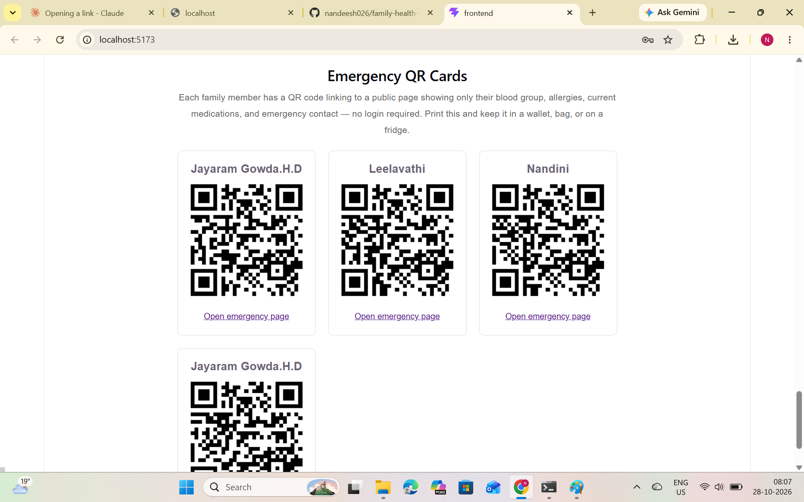

# Family Health Vault

A web app that keeps your family's health records in one place. Upload a lab report, and the app reads the values automatically and shows them as trend charts, so you can see changes over time.

## The problem it solves

Medical reports are paper or photos scattered across phones and folders. In an emergency, nobody can find allergies, medications or past results quickly. Family Health Vault stores everything per family member and gives an emergency page with the key details.

## Features

- Register, log in and log out
- Add and manage family members
- Upload lab report images; values are read automatically with OCR (Tesseract)
- Trend charts for values like Hemoglobin, Cholesterol, Fasting Blood Sugar, WBC and Platelet Count
- Out-of-range readings are highlighted in red
- Store allergies and medications for each member
- Emergency page with a QR card

## Tech stack

- **Backend:** Python, Flask
- **Database:** MySQL
- **Frontend:** React, Vite
- **OCR:** Tesseract with pytesseract

## Setup

1. Install Python, Node.js, MySQL and [Tesseract OCR](https://github.com/UB-Mannheim/tesseract/wiki).
2. Create a MySQL database for the app.
3. In the `backend` folder, create a `.env` file with your database details and a secret key.
4. Backend:
   ```
   cd backend
   python -m venv venv
   venv\Scripts\activate
   pip install -r requirements.txt
   python app.py
   ```
5. Frontend (in a second terminal):
   ```
   cd frontend
   npm install
   npm run dev
   ```
6. Open `http://localhost:5173` in your browser (works on your own computer once both servers are running)

## Screenshots

### Login


### Add a family member


### Medical reports with OCR


### Health trends


### Emergency QR card


## Notes

- The `.env` file is not included in this repo. Never upload it.
- Lab values are read with simple pattern matching, so results depend on report format.
- Sample data only. Not a medical device.